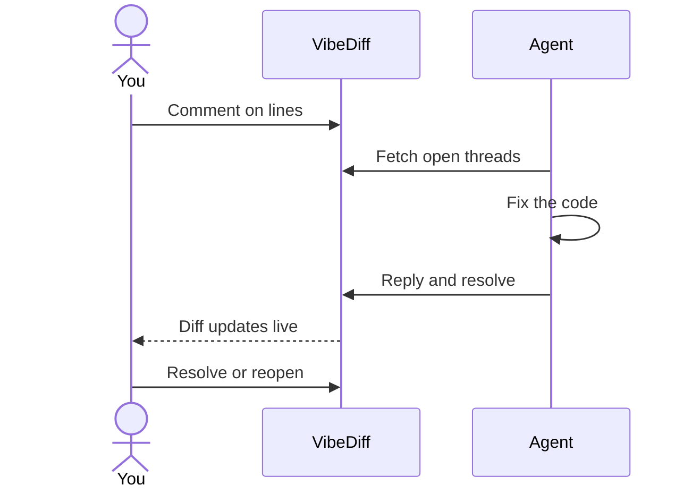

# VibeDiff

A local diff viewer for Git and Jujutsu, built for reviewing code that an AI agent wrote.

You read the diff, leave comments on the lines you don't like, and your agent picks them up, fixes the code, and replies in the same thread. No copy-pasting, no cloud service. One binary on your machine.


## Why

Agents write code faster than you can read it. The usual review loop (read the diff in a terminal, describe each problem in chat, hope the agent finds the right line) loses the one thing a review needs: precise, persistent feedback tied to the code.

VibeDiff gives you a proper review UI over your working copy and makes the comments machine-readable:

- **Line-anchored feedback.** Click a line, or drag across a range, and write what's wrong. The agent gets the file, line range and revision, not a paraphrase.
- **Threads that close.** The agent replies and resolves; you reopen if the fix is wrong. Thumbs up/down tells the agent which of its own findings were useful.
- **Agents can review too.** An agent can review your diff before a human sees it, or annotate a commit with the *why* behind each change.
- **Live.** The view updates as files change, so you watch the agent's fix land while you read.
- **Local.** Everything stays on your machine. It works in any Git or Jujutsu repo with no setup.

## Quick start

```bash
# Download a binary from the releases page, or build from source (see Installation)
cd your-repo
vibediff
```

A browser tab opens on `http://localhost:8888` showing your working copy diff. Click `+` on a line to comment. The help dialog lists every keyboard shortcut (`?`).

**Recommended:** run one instance in the background and keep it running, rather than starting VibeDiff in each repo. A single instance reviews any number of repos: add them from the directory switcher (or the API) and flip between them. Comments are kept per repo, and agents in every repo talk to the same URL.

```bash
vibediff -no-open &    # or run it under tmux, launchd or systemd
```

## A review in four steps



1. Run `vibediff` in the repo your agent is working in.
2. Review the diff and leave comments.
3. Tell the agent to check VibeDiff. It reads the open threads, fixes the code, and replies.
4. Read the new diff, resolve the threads that are fixed, reopen the ones that aren't.

The [workflows guide](docs/workflows.md) walks through this end to end, along with agent-written reviews, commit explanations, and reviewing branches.

## Highlights

- GitHub-style diffs, side-by-side or unified, with syntax highlighting and expandable context
- Single-line and range comments, threaded, with `user` / `agent` author badges and open / resolved status
- Comments pinned to the revision they were made against
- Revision browser: review any past commit, not only the working copy
- Mark files and revisions reviewed; marks clear if the content changes
- Several repos in one instance, with a directory switcher
- Keyboard shortcuts for the common actions, such as moving between files (`j`/`k`) and marking reviewed (`r`)
- Git and Jujutsu (jj) support
- Dark mode

## Documentation

- [Installation](docs/installation.md): releases, building from source, nix
- [Workflows](docs/workflows.md): worked examples of human and agent review loops
- [Usage](docs/usage.md): UI features, keyboard shortcuts, command line options
- [Agent integration](docs/agent-integration.md): REST API, comment model, and example [agent skills](skills/) to adapt. A running instance also serves live API docs at `/docs`
- [Development](docs/development.md): running locally, tests, tech stack

## License

MIT
